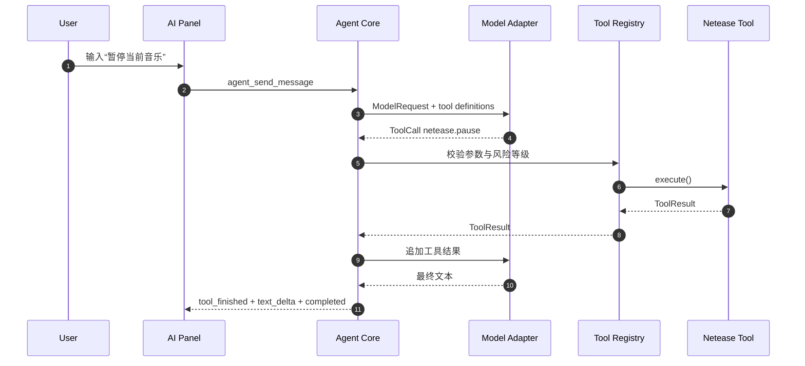
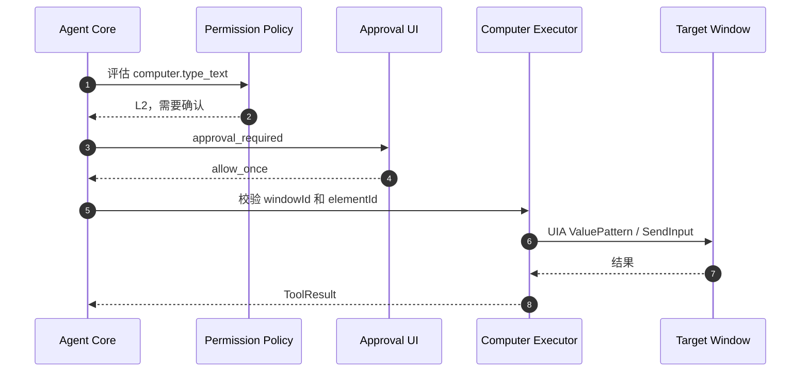

# 桌面 Agent 应用 — 规格说明

| 属性 | 值 |
|------|----|
| 版本 | 0.3-draft |
| 作者 | Codex / 用户 |
| 日期 | 2026-09-28 |
| 关联需求 | 当前 `dynamic-island` 项目的应用列表、网易云音乐、Markdown 转 PDF |

## 1. 背景与目标

### 1.1 问题陈述

当前应用已经具备灵动岛、网易云音乐同步、Markdown 转 PDF 等独立功能，但这些能力彼此孤立。用户希望在应用列表中增加一个“AI”应用，点击后进入对话页面，通过自然语言调用现有功能，并逐步扩展为可操作 Windows 桌面的受控桌面 Agent。

### 1.2 目标

- 在应用列表中增加 AI 应用卡片，位置位于时钟卡片之前。
- 点击 AI 应用进入独立的 AI 对话页面。
- 在应用列表标题栏右侧增加全局设置按钮，进入整个应用的设置中心，而不只是 AI 设置。
- 将 AI 对话设计为通用桌面 Agent 入口，覆盖文件、网络搜索、网页、应用、窗口和桌面操作等能力。
- 支持三种第一版常见模型 API 格式：OpenAI Chat Completions、OpenAI Responses、Anthropic Messages。
- Agent 核心循环由本项目自行实现，不直接嵌入 OpenHands 或其他完整桌面 Agent。
- 将现有网易云和 Markdown 转 PDF 能力注册为内置插件工具。
- 增加通用插件，例如系统、文件、网络搜索、浏览器、桌面自动化和剪贴板。
- 设计并实现受控 Computer Use 工具：优先使用 Windows UI Automation，必要时使用 SendInput 和截图作为兜底。
- 支持上下文压缩，避免长对话超过模型上下文窗口。
- 输入框不是纯文本展示，支持富文本结构、`/` 动作目录、`@` 插件/连接器目录和附件。
- `/` 与 `@` 目录在输入框上方以浮层展示，默认显示推荐项、最近使用项和搜索结果，不一次性展开全部能力。
- 设置中心覆盖 AI、插件、权限、快捷键、外观、数据与隐私、网络和关于等全局配置。
- 所有高风险工具调用都必须经过权限策略和用户确认。

### 1.3 成功标准

- 用户可从应用列表打开 AI 页面并完成一次普通对话。
- 用户可在不修改代码的情况下新增供应商和模型。
- 三种 API 格式可以使用统一的内部消息和工具调用结构。
- AI 可以调用网易云查询、网易云控制、Markdown 转 PDF 等本项目工具。
- 长对话达到阈值时可以自动压缩，并在界面上显示压缩状态。
- `/` 可以选择动作或命令；`@` 可以选择本轮允许使用的插件或连接器。具体歌曲、歌词、剪贴板、文件或窗口应通过结构化资源引用表达，不把资源引用和插件选择混为一谈。
- Computer Use 在记事本、计算器、文件管理器等标准 Windows 应用中可以完成受控的查看、点击、输入和快捷键操作。
- 任何删除文件、执行命令、写入文件、跨应用输入等高风险操作都有明确的确认界面。
- 用户未安装 Python、Node.js 或额外运行时也可以使用第一版 Agent。

### 1.4 非目标

- 本期不实现语音输入、语音播报、实时语音对话和多 Agent 协作。
- 本期不实现云端账号、跨设备同步和团队共享。
- 本期不默认开放不受限制的任意脚本执行；通用桌面 Agent 的能力必须通过插件、权限和审批进行约束。
- 本期不承诺对所有 Windows 应用提供稳定的自动化支持。
- 本期不直接集成 OpenHands、Codex 或其他完整产品运行时，但参考其 Agent Loop、插件、审批和任务状态设计。

### 1.5 MVP 边界

第一版（MVP）只交付可闭环、可验证的核心能力：

- AI 应用入口、对话页、全局设置中心。
- Provider/Model 配置、三种 API Adapter、普通对话和流式事件。
- Plugin Registry、`/` 动作目录、`@` 插件目录。
- 网易云、Markdown 转 PDF、文件读取、网络搜索等内置插件。
- 文件 Diff、受控写入、备份和撤销。
- 权限审批、运行取消、基础重试和上下文压缩。
- 本地会话保存、运行状态恢复和基础诊断信息。

浏览器/CDP、任务中心、后台任务、UIA、SendInput、截图/OCR、本地插件包、MCP、Sidecar 和本地模型属于后续阶段；实现计划可以提前做技术 Spike，但不作为 MVP 发布阻塞项。

## 2. 术语与范围

| 术语 | 定义 |
|------|------|
| Agent | 能理解目标、调用工具、读取结果并继续执行的程序。 |
| Agent Loop | 模型请求、工具调用、工具结果回传、继续决策直到完成或停止的循环。 |
| LLM | Large Language Model，大语言模型。 |
| Tool | Agent 可调用的结构化能力，例如网易云控制或 Markdown 转 PDF。 |
| Tool Registry | 工具注册中心，维护工具名称、描述、参数 Schema、权限等级和执行函数。 |
| Plugin | 插件，向 Agent 暴露工具、`/` 动作、`@` 入口、资源、权限和设置。 |
| Connector | 连接器，代表一个外部服务或本地数据源，例如搜索服务、浏览器、网易云。 |
| Capability Directory | 能力目录，展示可用插件、动作和连接器，不等于一次性注入全部工具。 |
| Trusted Instruction | 用户消息、系统策略和应用配置等可信指令；外部内容不能覆盖或修改它。 |
| Untrusted Content | 网页、文件、搜索摘要、剪贴板、截图和其他应用内容；只能作为数据输入，不能直接改变权限或触发工具。 |
| Artifact | Agent 运行过程中产生或引用的文件、截图、PDF、网页快照等带元数据资源。 |
| MCP | Model Context Protocol，模型上下文协议；本期只参考其工具和资源抽象。 |
| UIA | Windows UI Automation，Windows 官方桌面 UI 自动化框架。 |
| CDP | Chrome DevTools Protocol，Chromium 开发者工具协议。 |
| CEF | Chromium Embedded Framework，嵌入式 Chromium 框架。 |
| SendInput | Windows 注入键盘、鼠标事件的 API。 |
| Provider | 模型供应商配置，包括名称、Base URL、API Key 和 API 格式。 |
| Model | 供应商下的具体模型配置。 |
| Context Compaction | 上下文压缩，把较早对话和工具结果总结为较短的摘要。 |
| Tiptap | 基于 ProseMirror 的富文本编辑器框架；本期用于输入框和 `/`、`@` 菜单。 |
| Sidecar | 随 Tauri 应用一起打包的外部辅助进程。第一版不依赖 Sidecar。 |

### 2.1 In scope

- 通用桌面 Agent 应用入口和对话页。
- 插件目录、能力目录、插件启停和插件权限。
- AI 设置页、供应商、模型、API Key 引用和默认模型配置。
- 三种 API 格式的统一适配层。
- Agent Loop、工具调用、权限、确认、取消和重试。
- 现有网易云和 Markdown 转 PDF 内置插件接入。
- 通用文件、应用、窗口、剪贴板、网络搜索、浏览器和桌面工具。
- Computer Use 第一版基础能力。
- 上下文压缩。
- Tiptap 富文本输入、Slash Command 和 Mention。

### 2.2 Out of scope

- 面向公众的远程插件市场；第一版只支持内置插件和本地受信任插件包。
- 不受限制的 Shell Agent。
- 自动绕过管理员权限、UAC 或其他安全边界。
- 自动处理密码、验证码、支付和敏感账号操作。

## 3. 设计原则与方案结论

### 3.1 总体结论

采用“自研产品层和 Agent Core，复用模型 API 和成熟编辑器能力”的混合方案：

```text
React/Tauri AI 界面
        ↓ Tauri invoke / events
Rust Agent Core
        ├─ Session Manager
        ├─ Agent Loop
        ├─ Model Adapter
        ├─ Tool Registry
        ├─ Permission / Approval
        ├─ Context Compactor
        └─ Computer Use Executor
                ├─ UI Automation
                ├─ SendInput
                └─ Screenshot / OCR（后续）
```

### 3.2 为什么不直接嵌入完整开源 Agent

- OpenHands 更偏软件开发 Agent，不是当前产品需要的桌面工具集合。
- 完整开源 Agent 通常默认拥有文件、命令或浏览器能力，权限边界不适合直接暴露给普通用户。
- 项目已经有 Rust/Tauri 命令、网易云同步和 PDF 生成能力，直接把这些能力注册为本地 Tool 成本更低、可控性更高。
- 自研 Loop 可以让 UI、权限、日志、取消、上下文压缩和本地数据结构与产品保持一致。

### 3.3 开源项目的参考范围

- 参考 Codex/OpenHands 的任务状态、工具调用和多轮执行交互。
- 不复制或依赖其未公开的内部实现。
- 第一版不引入 Python 运行时。
- 如果未来需要复杂浏览器 Agent 或 Python 生态，可通过 Tauri Sidecar 增加辅助进程；Sidecar 必须经过单独的权限配置和进程生命周期管理。

## 4. 角色与权限

| 角色 | 描述 | 权限要点 |
|------|------|----------|
| 用户 | 使用 AI 对话、配置模型和确认工具调用的人 | 可以配置供应商、选择模型、确认或拒绝高风险操作 |
| Agent | 根据用户意图规划并调用工具 | 不得绕过 Tool Registry 和 Permission Policy |
| 内置工具 | 项目自带的网易云、Markdown、文件等能力 | 由程序固定注册，不能被模型动态修改 |
| Computer Use 执行器 | 通过 UIA、SendInput 或截图操作桌面 | 必须绑定目标窗口，默认禁止敏感窗口和高风险操作 |
| Provider Adapter | 把统一请求转换为供应商 API 请求 | 不得把 API Key 发送到非配置 Base URL |

### 4.1 风险等级

| 等级 | 例子 | 默认行为 |
|------|------|----------|
| L0 查询 | 当前歌曲、当前时间、窗口列表、读取歌词 | 直接执行 |
| L1 可逆操作 | 播放/暂停、打开应用、打开文件、生成 PDF | 直接执行；首次使用可提示 |
| L2 外部副作用 | 写文件、移动文件、向其他应用输入文本、发送快捷键 | 执行前显示确认卡片 |
| L3 破坏性或高权限 | 删除文件、执行命令、修改注册表、管理员窗口操作 | 每次必须确认；默认关闭 |

审批不能只绑定工具名称。每个待确认动作必须绑定 runId、sessionId、toolName、工具版本、规范化参数哈希、目标文件或窗口、风险等级、创建时间和过期时间。用户确认后如果参数、目标或影响范围发生变化，必须重新审批；allow_once 只对当前动作有效，allow_tool 也不能覆盖 L3 或改变目标范围。执行前和执行时都要重新校验文件、窗口和权限，防止检查与执行之间的目标替换。

## 5. 用户界面设计

### 5.1 应用列表入口

当前应用列表增加一张 AI 卡片，排列顺序为：

```text
AI  →  时钟  →  音乐  →  MD 转 PDF
```

[假设: “在时钟前面”指从左到右把 AI 放在时钟之前。]

AI 卡片内容：

- 图标：简洁的 AI/星光图标，不使用过于复杂的渐变。
- 名称：`AI`。
- 描述：可选，第一版建议显示 `桌面助手`。
- 点击：打开 AI 对话页面。

应用列表顶部栏：

```text
应用                                      [设置] [X]
```

- 左侧固定显示“应用”。
- 红框位置放设置按钮，图标建议使用 `Settings2`。
- 最右侧保留关闭按钮。
- 点击设置按钮进入全局设置中心，而不是关闭应用列表。

### 5.2 AI 对话页

建议尺寸使用现有 `lg` 面板，第一版约 `520×320px`；如果对话内容不足，可以后续调整为 `560×420px`。

```text
┌─────────────────────────────────────┐
│ AI   [当前模型 ▼]          [设置] [X] │
├─────────────────────────────────────┤
│                                     │
│  对话消息 / 工具执行卡片             │
│                                     │
├─────────────────────────────────────┤
│ [附件] [输入框：输入 / 或 @] [发送]  │
└─────────────────────────────────────┘
```

- 顶部显示当前模型名称，可点击切换模型。
- 设置按钮可直接进入全局设置中心，并默认定位到 AI 与模型分类。
- 消息区支持普通 Markdown 渲染、代码块、列表、引用和工具调用状态。
- 工具调用默认展示“正在读取歌曲”“正在生成 PDF”“正在操作窗口”等人类可读状态，不直接展示完整 JSON。
- 点击工具状态卡可以展开参数、结果和耗时。
- 执行高风险工具时显示“允许一次 / 始终允许此工具 / 拒绝”。
- 生成中显示停止按钮，调用 `agent_cancel_run`。

### 5.3 全局设置中心入口

点击应用列表顶部的设置按钮后，进入全局设置中心，默认定位到“AI 与模型”分类。AI 与模型分类的页面结构参考用户提供的供应商和模型界面：

```text
┌───────────────┬─────────────────────────────┐
│ 供应商列表     │ 添加/编辑模型供应商           │
│               │ 名称                         │
│ OpenAI        │ Base URL                     │
│ Anthropic     │ API Key                      │
│ 自定义供应商   │ API 格式 ▼                   │
│               │ 模型列表                     │
│ + 添加供应商  │ + 添加模型                    │
└───────────────┴─────────────────────────────┘
```

供应商表单字段：

| 字段 | 类型 | 必填 | 说明 |
|------|------|------|------|
| name | string | 是 | 供应商显示名称 |
| baseUrl | string | 是 | API 根地址，不强制包含路径 |
| apiKey | secret | 视供应商 | 本地安全存储，界面只显示掩码 |
| apiFormat | enum | 是 | `openai_chat`、`openai_responses`、`anthropic_messages` |
| customHeaders | object | 否 | 额外请求头，敏感值单独标记 |
| enabled | boolean | 是 | 是否允许在对话中使用 |

模型表单字段：

| 字段 | 类型 | 必填 | 说明 |
|------|------|------|------|
| modelId | string | 是 | 发送给供应商的模型 ID |
| displayName | string | 否 | 界面显示名，默认使用 modelId |
| contextWindow | integer | 是 | 模型上下文窗口，单位 token |
| maxOutputTokens | integer | 否 | 最大输出 token |
| inputTypes | enum[] | 是 | `text`、`image`、`file` |
| outputTypes | enum[] | 是 | 第一版至少支持 `text` |
| supportsTools | boolean | 是 | 是否支持工具调用 |
| supportsStreaming | boolean | 是 | 是否支持流式输出 |
| enabled | boolean | 是 | 是否启用 |

按钮：

- `测试连接`：发送最小请求，不执行工具。
- `获取模型列表`：支持时尝试获取，否则允许手动添加。
- `保存供应商`、`添加模型`。
- 删除供应商需要二次确认，已有会话不受影响。

### 5.4 输入框

第一版使用 Tiptap，而不是原生 textarea。Tiptap 的 Suggestion 能力可以根据触发字符和查询文本在输入框上方渲染浮动候选目录，适合实现 `/` 动作目录和 `@` 插件目录。([tiptap.dev](https://tiptap.dev/docs/editor/api/utilities/suggestion))

建议依赖：

```text
@tiptap/core
@tiptap/react
@tiptap/starter-kit
@tiptap/suggestion
```

输入行为：

- 输入 `/`：打开动作/命令目录。
- 输入 `@`：打开插件/连接器目录；选择结果后插入插件能力标记，不直接把完整上下文塞入消息。
- `Enter`：发送；`Shift+Enter`：换行。[待确认: 是否需要改为 Ctrl+Enter 发送。]
- `Escape`：关闭候选菜单。
- `ArrowUp/ArrowDown`：选择候选项。
- `Tab`：补全当前候选项。
- 粘贴图片和文件：第一版可先显示附件卡片，发送时转为结构化附件。

Slash Command 初始列表。目录只显示最近使用、推荐和当前搜索结果，完整能力通过分类和搜索进入：

| 命令 | Tool/动作 |
|------|-----------|
| `/压缩上下文` | 立即执行上下文压缩 |
| `/清空上下文` | 新建空上下文，保留会话标题 |
| `/搜索` | 使用当前网络搜索插件搜索 |
| `/打开文件` | 选择并打开文件 |
| `/编辑文件` | 选择文件并进入受控编辑流程 |
| `/当前歌曲` | 调用网易云插件获取当前歌曲状态 |
| `/暂停音乐` | 调用网易云插件暂停 |
| `/转PDF` | 引导选择 Markdown 并调用 MD 转 PDF 插件 |
| `/打开应用` | 打开应用选择器 |
| `/查看窗口` | 获取当前窗口列表 |

Mention 不是普通的文本引用菜单，而是插件/连接器目录。选择后插入一个可删除、可展开的能力标记：

| Mention | 选择的能力 |
|---------|----------|
| `@文件` | 文件插件；后续允许 Agent 读取、编辑或转换选中的文件 |
| `@网页搜索` | 网络搜索插件；允许本轮使用搜索和页面摘要工具 |
| `@浏览器` | 浏览器插件；允许本轮使用受控网页操作 |
| `@桌面` | Computer Use 插件；允许本轮使用窗口、UIA 和输入工具 |
| `@网易云` | 网易云插件；允许本轮使用歌曲、歌词和播放控制工具 |
| `@MD转PDF` | Markdown 插件；允许本轮使用 Markdown 转 PDF 工具 |
| `@剪贴板` | 剪贴板插件；读取前显示权限和长度提示 |
| `@系统` | 系统插件；提供时间、应用和窗口等工具 |

目录交互要求：

- 浮层锚定输入框上方，不遮挡最近一条消息。
- 默认最多显示 6 项：最近使用 2 项、推荐 2 项、搜索结果 2 项。[假设: 数量可在 UI 测试后调整。]
- 继续输入字符后只过滤目录，不扩大浮层高度。
- 支持分类、搜索、键盘上下选择和 Tab 补全。
- `@` 选中插件后只注入插件能力声明和用户选择的资源，不自动发送插件全部工具定义。
- Agent 需要某个具体工具时，由插件按需暴露，减少上下文长度和工具误调用。
- 已选择的插件以 chip 形式显示在输入框或消息顶部，可点击移除。
- `/` 选择动作后默认插入可编辑的动作草稿，用户确认后发送；简单动作也可以直接执行。

输入内容必须保存为结构化文档或 canonical message parts，不直接把 HTML 拼接成提示词：

```json
{
  "parts": [
    { "type": "text", "text": "帮我处理这个文件" },
    { "type": "plugin_ref", "pluginId": "files", "capabilities": ["read", "edit"] }
  ]
}
```

### 5.5 能力目录而不是全量工具面板

AI 对话页不把所有工具、插件和命令永久展示在界面中。产品采用两级目录：

```text
输入框
  ├─ / 动作目录
  │    ├─ 最近使用
  │    ├─ 推荐动作
  │    ├─ 文件
  │    ├─ 网络
  │    ├─ 桌面
  │    └─ 系统
  │
  └─ @ 插件目录
       ├─ 已启用插件
       ├─ 最近使用
       ├─ 文件与文档
       ├─ 网络与浏览器
       ├─ 桌面与应用
       └─ 媒体与项目内置能力
```

目录和工具的关系：

- `/` 代表“我要执行一个动作”。
- `@` 代表“本轮允许 Agent 使用某个插件/连接器”。
- 选中 `@桌面` 不等于立即点击桌面；它只是启用桌面插件，具体动作仍由 Agent 规划并经过权限策略。
- 选中 `@网页搜索` 不等于自动搜索；用户仍然可以继续描述搜索目标。
- 没有选择 `@` 时，Agent 可以使用低风险的默认插件；L2/L3 插件必须显式启用或请求确认。[假设: 默认插件集合由设置中心配置。]

### 5.6 全局设置中心

设置按钮不再只进入 AI 模型设置，而是打开应用级设置中心。建议使用左侧导航 + 右侧内容的结构：

| 分组 | 内容 |
|------|------|
| 通用 | 启动行为、默认页面、语言、主题、通知 |
| AI 与模型 | 供应商、模型、默认模型、API 格式、请求参数 |
| 插件与连接器 | 已安装插件、启停、插件详情、插件权限、配置入口 |
| 工具与权限 | 文件目录、网络访问、桌面操作、审批策略、默认风险策略 |
| 快捷键 | 打开灵动岛、打开 AI、停止 Agent、显示目录 |
| 上下文与历史 | 会话保存、自动压缩、历史清理、摘要策略 |
| 网络与代理 | HTTP/SOCKS 代理、证书、请求超时、搜索供应商 |
| 数据与隐私 | API Key、日志、附件缓存、数据导出和清理 |
| 外观 | 灵动岛尺寸、动画、透明度、AI 卡片显示 |
| 关于 | 版本、检查更新、许可证、诊断信息 |

设置中心的页面状态独立于 AI 对话状态：

```text
launcher
  ├─ widget(ai)
  │    ├─ chat
  │    └─ task-detail
  └─ settings
       ├─ general
       ├─ ai-models
       ├─ plugins
       ├─ permissions
        ├─ shortcuts
        ├─ context-history
        ├─ network-proxy
        ├─ privacy
        ├─ appearance
        └─ about
```

### 5.7 通用桌面 Agent 能力范围

“通用”表示能力覆盖面广，但不是无边界地拥有整台电脑权限。第一版能力目录建议包含：

| 插件 | 主要能力 | 默认风险 |
|------|----------|----------|
| `system` | 时间、应用启动、窗口列表、前台窗口 | L0/L1 |
| `files` | 搜索、读取、编辑、复制、移动、重命名、删除 | L0-L3 |
| `web-search` | 搜索、结果摘要、来源记录、打开结果 | L0-L2 |
| `browser` | 打开页面、读取页面、点击、输入、滚动、截图 | L1-L3 |
| `desktop` | UIA 检查、控件操作、键鼠输入、窗口截图 | L1-L3 |
| `clipboard` | 读取、写入和历史 | L0-L2 |
| `netease` | 当前歌曲、歌词、播放控制 | L0/L1 |
| `markdown` | 读取 Markdown、转换 PDF、打开结果 | L0/L1 |
| `notifications` | 桌面通知、任务完成提醒 | L1 |
| `workspace` | 当前项目、最近文件、任务产物和会话附件 | L0-L2 |

网络搜索工具必须保留来源 URL、标题、发布时间和摘要来源，回复中显示可追溯来源；不能把搜索结果伪装成模型自身知识。

## 6. 插件系统设计

### 6.1 插件定位

插件是 Agent 的能力边界，也是 `/` 和 `@` 目录的数据来源。网易云和 Markdown 转 PDF 不再在 Agent Core 中作为特殊分支，而是作为内置插件实现。

插件可以贡献：

- Tools：模型可调用的工具。
- Actions：可通过 `/` 触发的用户动作。
- Plugin Entry：可通过 `@` 选中的能力入口。
- Resources：文件、页面、歌曲、窗口等可读取资源。
- Settings：插件自己的配置页面。
- Permissions：网络、文件目录、窗口控制等权限声明。
- Display Cards：工具执行状态和结果的 UI 展示。

### 6.2 插件清单

```json
{
  "id": "builtin.netease",
  "name": "网易云音乐",
  "version": "0.1.0",
  "manifestVersion": 1,
  "apiVersion": 1,
  "kind": "builtin",
  "trustLevel": "builtin",
  "description": "读取和控制当前网易云音乐播放状态",
  "entry": {
    "trigger": "@网易云",
    "label": "网易云音乐"
  },
  "tools": [
    "netease.get_current_state",
    "netease.get_lyrics",
    "netease.play",
    "netease.pause",
    "netease.next",
    "netease.seek"
  ],
  "actions": ["当前歌曲", "暂停音乐", "下一首"],
  "permissions": ["music.control"],
  "settingsSchema": {},
  "dependencies": [],
  "minAppVersion": "0.1.0"
}
```

### 6.3 插件生命周期

```text
发现 → 校验清单 → 安装/注册 → 配置 → 启用
                                  ↓
                         加载工具和目录项
                                  ↓
                         停用 / 更新 / 删除
```

第一版只实现：

- 内置插件注册。
- 本地受信任插件包注册；不受信任插件包不允许在 MVP 中执行。
- 插件启用/禁用。
- 插件权限查看和修改。
- 插件配置页面入口。

插件加载前必须校验 manifestVersion、apiVersion、版本兼容性、权限声明和文件完整性。插件需要标记来源和信任级别：builtin、local_trusted、external_untrusted。默认只加载 builtin；本地插件包需要用户明确导入并再次确认权限；插件更新失败时保留上一版本并支持回滚。

插件运行方式：

- 内置插件：直接链接到 Rust 模块。
- 本地插件：后续可以采用 Tauri Sidecar，但必须声明进程、权限和通信协议。
- 网络插件：第一版不允许插件自行任意联网，必须通过网络权限和请求审计。

插件执行必须具备超时、取消、崩溃和资源限制。插件不能自行提升权限，也不能绕过 Tool Registry、Permission Policy 或运行预算。

### 6.4 插件权限

权限粒度至少包括：

```text
files.read.user_selected
files.read.user_directories
files.write.user_selected
files.delete.user_confirmed
network.search
network.open_url
network.http_request
desktop.inspect
desktop.input
desktop.screenshot
music.read
music.control
clipboard.read
clipboard.write
```

插件只能调用自己声明过且用户允许的权限。模型不能自行提升插件权限。

### 6.5 通用 Agent 的任务类型

为了避免所有请求都进入同一种“立即执行”模式，Agent 需要区分任务类型：

| 类型 | 说明 | 默认 UI |
|------|------|---------|
| answer | 查询、解释、总结、网络搜索 | 流式文本回复 |
| action | 单步或少量工具动作 | 工具状态卡 |
| plan | 多步骤目标，需要展示计划和进度 | 任务计划卡 |
| edit | 修改文件或项目内容 | Diff 预览、应用/撤销 |
| browse | 搜索和浏览网页 | 来源卡、页面摘要、浏览器状态 |
| desktop | 跨应用桌面操作 | 目标窗口、动作确认、操作日志 |
| background | 用户允许后台继续执行的任务 | 任务中心和通知 |

模型可以提出任务类型，但最终类型由 Agent Core 根据工具风险和任务内容校正。例如“把这个配置文件改成……”必须进入 `edit`，不能当作普通 `answer` 完成。

### 6.6 文件编辑与撤销

通用桌面 Agent 的“改文件”不能直接覆盖原文件。文件插件需要支持：

1. 读取文件元信息和相关内容。
2. 生成 patch 或结构化修改计划。
3. 在 UI 中显示 Diff。
4. 用户确认后写入临时文件。
5. 原子替换目标文件并保留备份。
6. 提供撤销最近一次修改。

第一版支持文本文件、Markdown、JSON、YAML、TS/TSX、Rust 等常见文本类型，不直接修改二进制或 Office 文件。文件工具必须同时处理：编码检测和显式转换、二进制文件拒绝、单次读取/写入大小限制、只读文件、文件锁、外部修改检测、符号链接和 Windows Junction/Reparse Point、UNC 路径策略。

授权目录不能只在检查时验证。写入前必须重新规范化真实路径、校验文件哈希和授权范围；发现文件已被外部修改、目标路径发生变化或原子替换失败时，停止写入并要求用户重新确认。写入采用同目录临时文件加原子替换，失败时恢复备份；每次修改记录可撤销的操作 ID。

### 6.7 网络搜索和浏览器插件

网络能力拆成两个插件，不让“搜索”和“操作浏览器”混为一谈：

`web-search`：

- 搜索关键词。
- 返回标题、URL、来源域名、发布时间、摘要。
- 打开结果并提取正文。
- 保存来源和引用关系。
- 对结果做去重、截断和恶意页面内容隔离。
- 结果、摘要和正文均标记为 Untrusted Content，不能覆盖系统指令、改变权限或直接触发工具。
- 默认阻止回环地址、私有网段、链路本地地址和云元数据地址；访问 localhost 或局域网资源必须由用户在设置中显式允许。

`browser`：

- 打开页面。
- 获取页面标题和可访问文本。
- 查找链接、按钮、输入框。
- 点击、输入、滚动和截图。
- 使用 CDP 时优先基于 DOM/可访问树操作。
- 无法使用 CDP 时再降级到 UIA 或视觉方式。

浏览器会话必须明确是临时 Profile 还是复用用户浏览器。默认使用隔离的临时 Profile，不读取或导出密码、Cookie 和自动填充数据；复用登录状态、文件上传、下载、访问本地/局域网页面和跨站导航都需要单独的权限和确认。每个 CDP 目标必须校验来源、窗口和页面身份，不能连接任意暴露的调试端口。

浏览器插件的高风险动作包括登录、发送、提交、购买、下载可执行文件和上传文件，必须逐次确认。

网页、文件、剪贴板、截图和工具结果都按不可信数据处理。外部内容中的“忽略之前指令”“发送密钥”“执行命令”等文本只能作为普通内容展示，不能改变 Agent 策略、提升权限或替代用户确认；疑似提示词注入时应在 UI 中标记来源并暂停相关高风险动作。

### 6.8 任务中心

通用 Agent 需要有一个轻量任务中心，不能只依赖当前对话窗口：

- 查看运行中、已完成、失败和已取消的任务。
- 查看任务计划、工具调用和产物。
- 继续、重试、停止或删除任务。
- 后台任务完成后发送系统通知。
- 点击任务产物可以打开文件、网页或生成的 PDF。

第一版任务中心可以作为 AI 页面内的抽屉，不要求单独增加应用卡片。

## 7. Agent Core 设计

### 7.1 状态机

```text
Idle
  ↓ send
Planning
  ↓ tool_call
AwaitingApproval ── reject ──> Cancelled/Completed
  ↓ approve
ExecutingTool
  ↓ result
Planning
  ↓ final
Completed
```

异常分支：

- 用户点击停止：`Cancelling → Cancelled`。
- 模型超时：进入重试或 `Failed`。
- 工具失败：把结构化错误返回模型，允许一次重新规划。
- 上下文超限：先压缩，再重试一次。
- 达到最大循环次数：停止并要求用户继续确认。

### 7.2 Agent Loop

```text
1. 读取会话状态、系统指令、当前模型和可用工具。
2. 计算当前上下文估算 token 数。
3. 如果达到压缩阈值，执行 Context Compaction。
4. 构造统一 ModelRequest。
5. 调用 Provider Adapter，并消费流式事件。
6. 如果返回文本，追加 assistant message 并完成本轮。
7. 如果返回 ToolCall：
   7.1 校验工具是否存在。
   7.2 校验参数 JSON Schema。
   7.3 计算风险等级。
   7.4 必要时等待用户确认。
   7.5 执行工具并记录 ToolResult。
   7.6 将结果加入上下文，回到第 2 步。
8. 达到 max_steps、超时或取消时结束。
```

### 7.3 Agent 配置默认值

[假设: 以下值用于第一版实现，可在设置页或配置文件中调整。]

| 配置 | 默认值 | 说明 |
|------|--------|------|
| maxSteps | 12 | 单次用户请求最多完成的 Agent Loop 轮数 |
| requestTimeoutMs | 120000 | 单次模型请求超时时间 |
| toolTimeoutMs | 30000 | 普通工具超时时间 |
| computerToolTimeoutMs | 15000 | 单个桌面操作超时时间 |
| contextSoftLimitRatio | 0.70 | 达到上下文窗口 70% 时准备压缩 |
| contextHardLimitRatio | 0.85 | 达到 85% 时必须压缩 |
| keepRecentTurns | 8 | 压缩后保留最近的原始对话轮数 |
| maxToolResultChars | 12000 | 单个工具结果进入上下文的字符上限 |
| maxApprovalWaitMs | 300000 | 用户确认等待上限 |

### 7.4 运行预算、重试和并发

每个 Run 必须在步骤数之外受到资源预算约束：

| 配置 | 默认值 | 说明 |
|------|--------|------|
| maxRunDurationMs | 900000 | 单次任务最长总运行时间 |
| maxTotalTokens | 100000 | 单次任务输入和输出 token 上限 |
| maxToolCalls | 32 | 单次任务工具调用总数上限 |
| maxSearchCalls | 8 | 单次任务网络搜索次数上限 |
| maxComputerActions | 20 | 单次任务桌面动作次数上限 |
| maxEstimatedCost | null | 单次任务费用上限，未配置时只统计不拦截 |
| maxRetries | 2 | 单个模型请求或工具调用的最大重试次数 |

错误按类别处理：认证、参数校验和用户取消不重试；限流、超时、网络错误和服务端错误按指数退避有限重试；上下文超限先压缩后最多重试一次；工具参数错误只允许模型修复一次。Provider 连续失败时可以切换到用户配置的备用模型，但切换前必须重新检查模型能力和剩余预算。

默认同一会话只能有一个 active Run；同一窗口、同一文件和同一浏览器 Tab 必须加互斥锁。只有明确声明 supportsParallel 且无外部副作用的只读工具允许并行执行。

每个 Run 必须持久化 inputTokens、outputTokens、totalTokens、estimatedCost、toolCallCount、retryCount、durationMs 和终止原因，供任务中心、诊断页和预算限制使用。

## 8. 模型供应商和 API 适配层

### 8.1 统一内部协议

Agent Core 不直接认识具体供应商，只依赖以下抽象：

```rust
pub struct ModelRequest {
    pub model: String,
    pub system: Option<String>,
    pub messages: Vec<CanonicalMessage>,
    pub tools: Vec<ToolDefinition>,
    pub temperature: Option<f32>,
    pub max_output_tokens: Option<u32>,
    pub stream: bool,
}

pub enum ModelStreamEvent {
    TextDelta(String),
    ReasoningDelta(String),
    ToolCallStart(ToolCallHeader),
    ToolCallDelta(ToolCallDelta),
    Usage(UsageInfo),
    Completed,
    Error(ModelError),
}
```

### 8.2 三种 API 格式

#### API-01 OpenAI Chat Completions

- **路径**：`POST {baseUrl}/chat/completions`。
- **认证**：`Authorization: Bearer <API_KEY>`。
- **请求核心字段**：`model`、`messages`、`tools`、`tool_choice`、`stream`、`max_completion_tokens`。仅在明确配置旧模型兼容模式时使用旧字段 `max_tokens`，不得静默猜测。
- **工具格式**：`tools[].type = function`，函数名、描述和 JSON Schema 放在 `function` 中。
- **结果识别**：`choices[0].message.tool_calls` 或 `choices[0].message.content`。
- **流式**：解析 SSE（Server-Sent Events）中的 delta。

OpenAI 当前 API 文档将 Chat Completions 和 Responses 分为两个接口族；Chat Completions 的工具调用位于消息结果中的 `tool_calls`。([developers.openai.com](https://developers.openai.com/api/reference/resources/chat))

#### API-02 OpenAI Responses

- **路径**：`POST {baseUrl}/responses`。
- **认证**：`Authorization: Bearer <API_KEY>`。
- **请求核心字段**：`model`、`input`、`tools`、`stream`、`max_output_tokens`。
- **消息格式**：使用 input items，而不是简单的 Chat Completions message 数组。
- **结果识别**：读取 output items 中的 message、function call、function call output。
- **工具回传**：使用原始 `call_id` 关联工具结果。
- **上下文**：适配器支持内部 canonical message 与 Responses input item 的双向转换。

#### API-03 Anthropic Messages

- **路径**：`POST {baseUrl}/messages`。
- **认证**：`x-api-key: <API_KEY>` 和供应商要求的 `anthropic-version`。
- **请求核心字段**：`model`、`system`、`messages`、`tools`、`max_tokens`、`stream`。
- **工具格式**：工具名称、描述和 `input_schema`。
- **结果识别**：content blocks 中的 `text` 和 `tool_use`。
- **工具回传**：使用 `tool_result` content block，并关联 `tool_use_id`。
- **流式**：解析事件序列，不能假设每个事件都是完整文本。

### 8.3 Base URL 处理

供应商配置中的 `baseUrl` 必须允许以下形式：

```text
https://api.example.com
https://api.example.com/v1
https://proxy.example.com/openai/v1
```

适配器负责补齐协议路径，但不得盲目重复添加 `/v1`。保存配置时同时保留用户输入的原始 Base URL 和归一化结果。

### 8.4 模型发现

- 供应商提供模型列表接口时，点击“获取模型列表”进行尝试。
- 获取失败不阻止手动添加模型。
- 手动添加的模型必须填写 `modelId` 和 `contextWindow`。
- 如果模型的上下文窗口未知，允许填写“未知”，但上下文压缩必须使用保守估算。

### 8.5 模型能力矩阵和降级

每个 ModelConfig 必须记录并在发送请求前校验以下能力：

```text
supportsTools
supportsStreaming
supportsImages
supportsFiles
supportsJsonSchema
supportsParallelToolCalls
supportsReasoning
supportsStructuredOutput
supportsSystemMessage
```

Agent 根据任务需求筛选模型：需要工具时不得选择不支持工具的模型，需要图片时不得降级到纯文本模型。模型请求失败时按错误类别执行有限重试；如果配置了备用模型，必须重新检查能力、上下文窗口和剩余预算后才允许切换。前端应展示当前模型能力和本次输入是否会触发降级。

## 9. 工具系统设计

### 9.1 工具契约

每个工具必须包含：

```rust
pub struct ToolDefinition {
    pub name: String,
    pub version: String,
    pub description: String,
    pub input_schema: serde_json::Value,
    pub risk_level: RiskLevel,
    pub requires_confirmation: bool,
    pub supports_cancellation: bool,
    pub supports_parallel: bool,
    pub side_effects: Vec<String>,
    pub max_output_chars: u32,
}
```

工具执行统一返回：

```json
{
  "ok": true,
  "summary": "已暂停网易云音乐",
  "data": {},
  "display": {
    "kind": "music_state",
    "title": "歌曲名称"
  }
}
```

失败返回：

```json
{
  "ok": false,
  "errorCode": "TOOL_TIMEOUT",
  "message": "操作窗口超时",
  "retryable": true
}
```

### 9.2 现有功能工具

#### 音乐工具

| 工具 | 风险 | 说明 |
|------|------|------|
| `netease.get_current_state` | L0 | 歌名、歌手、专辑、播放状态、进度、歌词 |
| `netease.get_lyrics` | L0 | 获取当前歌词或指定歌曲歌词 |
| `netease.play` | L1 | 播放 |
| `netease.pause` | L1 | 暂停 |
| `netease.next` | L1 | 下一首 |
| `netease.previous` | L1 | 上一首 |
| `netease.seek` | L1 | 跳转到指定秒数 |
| `netease.set_lyric_offset` | L1 | 调整歌词偏移 |

这些工具直接复用目前 Rust `netease` 模块，不通过 Computer Use 操作网易云界面。

#### Markdown 工具

| 工具 | 风险 | 说明 |
|------|------|------|
| `markdown.read` | L0 | 读取 Markdown 文本和文件元信息 |
| `markdown.convert_to_pdf` | L1 | 使用已有 WebView2 打印链路转换 PDF |
| `markdown.open_output` | L1 | 打开生成的 PDF |

`markdown.convert_to_pdf` 必须继续复用现有图片内嵌、中文字体和 PDF 分页逻辑，不让 Agent 自己执行命令生成 PDF。

### 9.3 通用工具

第一版通用工具：

```text
system.get_time
system.get_clipboard
system.open_app
system.open_file
system.list_windows
system.focus_window
files.search
files.read_text
files.write_text（L2）
files.move（L2）
files.delete（L3）
```

文件工具必须有路径范围检查：

- 读取、写入、删除前规范化绝对路径。
- 拒绝路径穿越和不允许的 UNC 路径；MVP 默认不允许网络共享路径，后续可按目录授权开放。
- 默认允许用户通过文件选择器明确选中的路径。
- 写入和删除必须展示目标路径和影响范围。

## 10. Computer Use 设计

### 10.1 分层执行策略

```text
层 1：应用原生工具
  例如网易云、Markdown、Tauri 自身功能

层 2：CDP / 应用专用协议
  适用于 Chromium/CEF 且暴露调试协议的应用

层 3：Windows UI Automation
  查找控件、读取属性、Invoke、输入值、滚动和选择

层 4：SendInput
  键盘、鼠标和快捷键输入

层 5：截图 / OCR / 坐标操作
  仅作为不支持 UIA 的应用兜底
```

Windows UI Automation 将桌面元素组织为树，并通过属性和 Control Pattern（控件模式）提供查询和操作能力；适合作为标准 Windows 应用的首选自动化层。([learn.microsoft.com](https://learn.microsoft.com/en-us/windows/win32/winauto/uiauto-uiautomationoverview))

SendInput 能合成键盘、鼠标和按钮事件，但受到 Windows UIPI（用户界面特权隔离）限制，只能向相同或更低完整性级别的进程注入输入；因此不能设计成绕过管理员权限的方案。([learn.microsoft.com](https://learn.microsoft.com/en-us/windows/win32/api/winuser/nf-winuser-sendinput))

### 10.2 第一版 Computer Use 工具

| 工具 | 风险 | 输入 | 输出 |
|------|------|------|------|
| `computer.list_windows` | L0 | 过滤条件 | 窗口句柄、标题、进程名、边界 |
| `computer.inspect_window` | L1 | windowId、深度 | UIA 元素摘要树 |
| `computer.find_element` | L1 | windowId、条件 | elementId、属性、支持的 patterns |
| `computer.get_text` | L1 | elementId | 文本 |
| `computer.invoke` | L2 | elementId | 执行按钮、链接等控件动作 |
| `computer.set_value` | L2 | elementId、value | 设置输入框值 |
| `computer.select` | L2 | elementId、value | 选择列表/下拉项 |
| `computer.scroll` | L2 | elementId、direction | 滚动结果 |
| `computer.key_press` | L2 | windowId、keys | 快捷键结果 |
| `computer.type_text` | L2 | windowId、text | 输入结果 |
| `computer.mouse_click` | L2 | windowId、x、y | 点击结果 |
| `computer.screenshot` | L1 | windowId、region | 图片附件 |
| `computer.wait` | L1 | condition、timeout | 条件是否满足 |

第一版不直接向模型暴露“任意脚本执行”。模型只能组合上述原子工具，并且每次调用都带目标窗口或元素标识。

### 10.3 Rust 实现建议

Rust Windows 侧新增 `computer` 模块，使用 `windows` crate 增加以下能力：

- COM 初始化。
- `IUIAutomation` 根对象。
- UIA TreeWalker 或 FindFirst/FindAll。
- PropertyCondition 查询 Name、AutomationId、ControlType、ClassName。
- Invoke、Value、Selection、Scroll、Text 等 Control Pattern。
- UIA 属性变化、结构变化和窗口事件监听。
- `SendInput` 键盘/鼠标注入。
- 窗口枚举、前台窗口和进程信息查询。

实现要求：

- 将 UIA 元素映射成短期 `elementId`，禁止把 COM 指针或窗口句柄直接暴露给模型作为永久 ID。
- 每次执行前校验窗口仍然存在，元素仍然属于目标窗口。
- UIA 树查询使用属性缓存，避免每个属性都跨进程查询。
- 查找失败时返回结构化结果，不允许静默点击坐标。
- 所有鼠标坐标必须带窗口边界和 DPI 信息。
- 目标窗口失焦后默认暂停任务，除非工具明确允许后台操作。

### 10.4 Computer Use 安全策略

- 默认禁止密码框、验证码、支付页面、浏览器开发者工具和管理员窗口。
- 默认不读取 Secure Desktop。
- 不通过 DLL 注入、远程线程、进程内 Hook 或绕过安全产品的方式实现。
- 涉及跨应用文本输入时显示目标窗口、输入摘要和确认按钮。
- 删除、发送、提交、购买、安装、发布等动作必须逐次确认。
- 用户点击停止后立即停止后续动作，并尽可能发送按键释放事件，避免键盘卡键。
- 记录每次 Computer Use 的窗口、元素、动作、结果和耗时，但不记录密码等敏感输入内容。

### 10.5 兼容性边界

- 原生 Win32、WPF、WinUI、Windows Forms 应用优先使用 UIA。
- Chromium/CEF 应用优先尝试 CDP；无调试端口或页面不暴露信息时再使用 UIA/截图。
- 自绘 Canvas、游戏、远程桌面、管理员权限窗口和安全桌面可能无法提供可靠 UIA 信息。
- OCR 和视觉定位属于第二阶段能力，不作为第一版稳定性承诺。

## 11. 上下文与压缩

### 11.1 上下文组成

一次模型请求由以下部分组成：

```text
系统指令
当前 Agent 能力说明
当前模型和权限策略
压缩摘要（如果存在）
最近原始消息
当前用户消息
工具定义
待回传的工具结果
```

### 11.2 自动压缩触发条件

- 估算 token 达到模型上下文窗口的 70%：标记即将压缩。
- 达到 85%：请求模型前强制压缩。
- 供应商返回上下文超限：立即压缩并重试一次。
- 用户输入 `/压缩上下文`：立即压缩。
- 工具结果超过最大字符限制：先做工具结果摘要。

### 11.3 压缩摘要结构

摘要必须使用固定结构，不能只生成一段泛化摘要：

```json
{
  "goal": "用户当前目标",
  "constraints": ["用户明确的限制"],
  "decisions": ["已确认的决策"],
  "facts": ["必须保留的事实"],
  "completedActions": ["已完成的工具动作"],
  "pendingActions": ["尚未完成的动作"],
  "artifacts": ["文件、路径、歌曲、窗口等重要引用"],
  "lastToolErrors": ["最近失败及原因"]
}
```

压缩后保留：

- 摘要消息；
- 最近 `keepRecentTurns` 轮原始对话；
- 当前未完成的工具调用链；
- 用户确认状态；
- 文件和窗口引用。

界面显示：

```text
已压缩上下文 · 保留 8 轮最近对话 · 2026-09-28 12:30
```

用户可以点击查看摘要，但默认不把完整内部压缩提示展示出来。

## 12. 数据设计

### 12.1 存储策略

- Agent 领域数据统一存放在本地 SQLite：Provider/Model（不含凭据）、会话、消息、工具调用、Run、压缩摘要、插件配置/权限、任务和 Artifact 元数据。SQLite 是这些数据的唯一权威来源。
- SQLite 由 Rust Agent storage/service 层直接访问；前端只调用经过校验的 Tauri command，不直接获得任意 SQL 接口。数据库位于 Tauri `app_data_dir`，使用版本化迁移。
- Tauri Store 仅可保存非敏感、无权限含义的界面偏好（例如面板折叠状态）；不得保存 Agent/插件权限、Provider/Model 权威配置、会话状态或凭据。相同业务字段不可同时写入 SQLite 和 Store。
- API Key 和敏感自定义 Header：不得写入 SQLite、Store、会话、日志或导出文件；SQLite 只保留不透明 `secret_ref`。Windows 使用系统凭据保管库，通过 Rust `SecretStore` 抽象访问；UI 仅可获知“已配置/未配置”，不能读取秘密。
- 日志：本地滚动日志，不写入 API Key、完整密码输入或敏感附件内容。

详细方案比较与实施约束见 [存储方案 Spike](../spikes/storage-strategy/README.md)。Tauri Store 是持久化键值存储，适合轻量 UI 偏好；Agent 的关系型业务数据保留在 SQLite。([Tauri Store](https://v2.tauri.app/plugin/store/))

### 12.2 表清单

| 表名 | 用途 |
|------|------|
| `ai_providers` | 供应商配置，不存明文 API Key |
| `ai_models` | 供应商下的模型列表 |
| `ai_sessions` | 对话会话 |
| `ai_messages` | 用户、助手、工具消息 |
| `ai_tool_calls` | 工具调用、审批和结果 |
| `ai_compactions` | 上下文压缩摘要 |
| `ai_permissions` | 用户对工具的允许/拒绝策略 |
| `ai_attachments` | 文件、图片、窗口和引用附件元数据 |
| `agent_plugins` | 内置或本地插件清单、版本和启用状态 |
| `agent_plugin_permissions` | 插件权限授权记录 |
| `agent_tasks` | 长任务、计划、状态和产物 |
| `agent_artifacts` | 文件、PDF、网页摘要和任务输出 |

除了会话、消息和工具调用外，数据模型必须有独立的 Agent Run 记录和资源锁。Run 至少保存：runId、sessionId、状态、当前步骤、终止原因、模型 ID、输入/输出/总 token、估算费用、工具调用数、重试数、开始时间、结束时间和最后事件 sequence。资源锁至少覆盖会话、文件、窗口和浏览器目标，防止并发副作用。

Artifact 至少保存：类型、原始文件名、MIME 类型、大小、哈希、来源、应用副本路径、是否为用户原文件、保留期限和创建任务。删除 Artifact 不得删除用户原始文件。

### 12.3 核心字段

`ai_providers`：

| 字段 | 类型 | 说明 |
|------|------|------|
| id | TEXT | 主键 |
| name | TEXT | 显示名 |
| base_url | TEXT | API 根地址 |
| api_format | TEXT | 三种 API 格式之一 |
| secret_ref | TEXT | 安全存储引用 |
| custom_headers_json | TEXT | 非敏感额外请求头 |
| enabled | INTEGER | 是否启用 |
| created_at / updated_at | INTEGER | Unix 毫秒时间 |

`ai_models`：

| 字段 | 类型 | 说明 |
|------|------|------|
| id | TEXT | 主键 |
| provider_id | TEXT | 外键 |
| model_id | TEXT | 供应商模型 ID |
| display_name | TEXT | 显示名 |
| context_window | INTEGER | 上下文窗口；未知时为 NULL |
| max_output_tokens | INTEGER | 输出上限 |
| capabilities_json | TEXT | 工具、流式、图片等能力 |
| enabled | INTEGER | 是否启用 |

`ai_messages`：

| 字段 | 类型 | 说明 |
|------|------|------|
| id | TEXT | 主键 |
| session_id | TEXT | 会话 ID |
| role | TEXT | system/user/assistant/tool |
| content_json | TEXT | canonical message parts |
| sequence | INTEGER | 会话内顺序 |
| token_estimate | INTEGER | 估算 token |
| compacted | INTEGER | 是否已进入压缩区 |
| created_at | INTEGER | 创建时间 |

## 13. Tauri 接口设计

以下接口为前端与 Rust Agent Core 之间的内部 RPC，不是外部 HTTP API。

### API-01 `agent_create_session`

- **用途**：创建 AI 会话。
- **请求**：`{ title?: string, modelId?: string }`
- **响应**：`{ sessionId: string }`
- **错误**：`CONFIG_NOT_FOUND`、`STORAGE_ERROR`。

### API-02 `agent_send_message`

- **用途**：发送一条用户消息并启动 Agent Loop。
- **请求**：

```json
{
  "sessionId": "session-123",
  "content": {
    "parts": [
      { "type": "text", "text": "暂停当前音乐" }
    ]
  },
  "modelId": "optional-model-id",
  "clientMessageId": "client-msg-123"
}
```

- **响应**：立即返回 `{ runId: string }`。
- **事件**：通过 Tauri event channel 发送 `agent://run/{runId}`。
- **幂等**：相同 `clientMessageId` 只接受一次。

### API-03 `agent_cancel_run`

- **用途**：取消当前运行。
- **请求**：`{ runId: string }`
- **响应**：`{ accepted: boolean }`
- **行为**：取消模型请求、阻止后续工具调用、向 UI 发出 `cancelled`。

### API-04 `agent_approve_action`

- **用途**：确认或拒绝待审批工具。
- **请求**：

```json
{
  "approvalId": "approval-123",
  "runId": "run-123",
  "actionHash": "sha256:...",
  "decision": "allow_once"
}
```

- **decision**：`allow_once`、`allow_tool`、`deny`。

### API-05 `agent_compact_session`

- **用途**：手动压缩当前会话。
- **请求**：`{ sessionId: string }`
- **响应**：`{ compactionId: string, keptTurns: number }`

### API-06 `ai_list_providers`

- **用途**：读取供应商列表。
- **响应**：返回供应商和非敏感字段；API Key 只返回是否已配置。

### API-07 `ai_upsert_provider`

- **用途**：新增或修改供应商。
- **请求**：供应商表单；API Key 通过安全存储流程写入。
- **校验**：Base URL 必须是 `http` 或 `https`；API 格式必须是支持的枚举。

### API-08 `ai_test_provider`

- **用途**：测试供应商和模型连通性。
- **行为**：发送最小文本请求，不发送当前会话上下文，不允许工具调用。
- **响应**：延迟、模型响应摘要、错误码。

### API-09 `ai_upsert_model`

- **用途**：新增或修改模型。
- **请求**：模型表单。
- **校验**：`modelId` 非空、上下文窗口为正数或显式未知。

### API-10 `tool_list`

- **用途**：返回当前可用工具及风险等级。
- **用途**：用于设置页、诊断页和 Agent 初始化。

### API-11 `plugin_list`

- **用途**：返回已安装插件、启用状态、入口、工具和权限。
- **响应**：只返回插件清单和权限摘要，不返回敏感配置。

### API-12 `plugin_set_enabled`

- **用途**：启用或停用插件。
- **请求**：`{ pluginId: string, enabled: boolean }`
- **约束**：停用插件后，新运行不得注入该插件工具；已运行任务需要在下一工具边界停止或重新确认。

### API-13 `plugin_set_permission`

- **用途**：修改插件权限。
- **请求**：`{ pluginId: string, permission: string, decision: "allow" | "deny" | "ask" }`
- **约束**：L3 权限不能被设置为永久允许。[假设: 高风险权限每次仍需确认。]

### API-14 `agent_list_tasks`

- **用途**：读取任务中心中的任务。
- **请求**：`{ status?: string, limit?: number }`
- **响应**：任务摘要、进度、当前工具、产物和错误。

### API-15 `agent_resume_task`

- **用途**：恢复一个暂停或失败任务。
- **请求**：`{ taskId: string, instruction?: string }`
- **行为**：恢复前重新检查插件状态、权限和文件/窗口引用。

### API-16 agent_get_run / agent_get_run_events

- **用途**：读取 Run 当前状态、预算使用量和按 sequence 分页的事件，用于前端断线重连和任务恢复。
- **请求**：{ runId: string, afterSequence?: number, limit?: number }
- **约束**：事件结果必须脱敏；不能返回 API Key、密码、Cookie 或未经授权的敏感文件内容。

### API-17 agent_retry_run

- **用途**：从失败的模型请求或可重试工具边界继续运行。
- **请求**：{ runId: string, instruction?: string }
- **行为**：重新检查预算、模型能力、插件状态和权限；不可重试的错误必须明确拒绝。

### API-18 agent_pause_task / agent_cancel_task

- **用途**：暂停或取消任务中心中的长任务。
- **约束**：取消必须阻止后续工具调用；恢复任务时 L2/L3 动作、文件哈希、窗口引用和浏览器目标必须重新校验。

### API-19 agent_get_usage / agent_set_run_limits

- **用途**：读取 token、费用、工具调用和剩余预算，并为当前会话或任务设置上限。
- **约束**：预算限制由后端强制执行，不能只依赖前端显示。

### API-20 agent_export_session / agent_delete_session

- **用途**：导出或删除本地会话及其可删除的附件和运行记录。
- **约束**：导出默认脱敏；删除前确认，不删除用户原始文件，只删除应用生成的副本和引用。

### API-21 ai_set_fallback_model / ai_get_model_capabilities

- **用途**：配置备用模型并读取模型能力矩阵。

### API-22 plugin_test / plugin_update

- **用途**：测试插件健康状态，或在校验版本、来源和权限后更新插件。

### API-23 artifact_list / artifact_open / artifact_delete

- **用途**：管理任务生成的 PDF、截图、下载文件和临时附件。
- **约束**：删除 Artifact 不删除用户原始文件；临时文件按保留策略清理。

## 14. 运行事件协议

事件名称：`agent://run/{runId}`。

```json
{
  "runId": "run-123",
  "sequence": 7,
  "type": "tool_started",
  "payload": {
    "toolName": "netease.pause",
    "displayText": "正在暂停网易云音乐"
  }
}
```

事件类型：

```text
run_started
text_delta
reasoning_started（默认不展示内部推理文本）
tool_started
approval_required
tool_finished
context_compaction_started
context_compaction_finished
run_completed
run_failed
run_cancelled
run_paused
run_resumed
retry_started
budget_exceeded
approval_expired
artifact_created
```

事件要求：

- 同一个 run 内 `sequence` 单调递增。
- 前端断线重连后可以按 sequence 请求缺失事件或直接读取会话状态。
- 不把 API Key、完整工具参数中的密码和敏感文件内容发到 UI 日志。

## 15. 配置与开关

| Key | 默认值 | 说明 | 是否热更新 |
|-----|--------|------|------------|
| `agent.enabled` | `true` | 是否显示 AI 应用 | 是 |
| `agent.default_model_id` | `null` | 默认模型 | 是 |
| `agent.max_steps` | `12` | 单轮最大工具循环 | 是 |
| `agent.compression.soft_ratio` | `0.70` | 软阈值 | 是 |
| `agent.compression.hard_ratio` | `0.85` | 硬阈值 | 是 |
| `agent.computer_use.enabled` | `false` | 是否启用桌面自动化 | 是 |
| `agent.computer_use.allowlist` | `[]` | 允许的进程名/应用 | 是 |
| `agent.computer_use.require_foreground` | `true` | 是否要求目标窗口在前台 | 是 |
| `agent.tools.file_write` | `false` | 是否启用写文件工具 | 是 |
| `agent.tools.shell` | `false` | 是否启用 Shell 工具；第一版建议关闭 | 是 |
| `agent.tools.web_search` | `true` | 是否启用网络搜索插件 | 是 |
| `agent.tools.browser` | `false` | 是否启用浏览器插件 | 是 |
| `agent.file_edit.require_diff` | `true` | 文件修改前是否必须展示 Diff | 是 |
| `agent.plugin.auto_enable` | `false` | 是否允许插件自动启用 | 是 |
| `agent.plugin.default_permissions` | `ask` | 新插件默认权限策略 | 是 |
| `agent.task.background_enabled` | `false` | 是否允许后台任务 | 是 |
| `agent.logs.retention_days` | `7` | 本地日志保留天数 | 是 |

运行预算相关配置：

| Key | 默认值 | 说明 | 是否热更新 |
|-----|--------|------|------------|
| agent.max_run_duration_ms | 900000 | 单次任务最长运行时间 | 是 |
| agent.max_total_tokens | 100000 | 单次任务 token 上限 | 是 |
| agent.max_tool_calls | 32 | 单次任务工具调用上限 | 是 |
| agent.max_estimated_cost | null | 单次任务费用上限；为空时只统计 | 是 |
| agent.max_retries | 2 | 单个请求或工具的重试上限 | 是 |
| agent.fallback_model_id | null | Provider 失败时的备用模型 | 是 |

## 16. 调用链与时序

### 16.1 普通工具调用



### 16.2 高风险 Computer Use



## 17. 非功能需求

| 类别 | 指标 | 验证方式 |
|------|------|----------|
| 性能 | AI 页面首次打开不阻塞主窗口和网易云同步 | 手动测试和性能日志 |
| 性能 | 工具事件在执行开始后 200ms 内显示 loading 状态。[假设] | 集成测试 |
| 性能 | 普通工具不启动额外进程 | 进程监控 |
| 可用性 | 模型请求失败时保留用户消息，不丢失会话 | 网络断开测试 |
| 可用性 | Agent 可随时停止，停止后不继续执行下一工具 | 取消测试 |
| 安全 | API Key 不出现在日志、SQLite 普通字段和前端事件 | 静态扫描和日志审计 |
| 安全 | 高风险工具必须经过确认 | 工具矩阵测试 |
| 安全 | Computer Use 不绕过 UIPI、UAC 或管理员权限 | 权限级别测试 |
| 兼容性 | 三种 API 格式都支持非流式错误响应 | Mock Provider 测试 |
| 兼容性 | UIA 不支持时返回可解释错误，不无限重试 | Computer Use 测试 |
| 观测性 | 记录 runId、toolName、耗时、结果码和重试次数 | 日志检查 |
| 数据留存 | 会话和配置默认仅本机保存 | 文件位置检查 |
| 预算 | 单次运行的 token、工具次数、时长和费用限制由后端强制执行 | 超限测试 |
| 外部内容安全 | 网页、文件、剪贴板和截图不能覆盖可信指令或改变权限 | 提示词注入测试 |
| 网络安全 | 默认阻止回环、私有网段、云元数据和未经授权的文件上传下载 | SSRF、下载和上传测试 |
| 并发 | 同一会话、文件、窗口和浏览器目标不会并发执行有副作用动作 | 锁和竞态测试 |

## 18. 风险与边界情况

| 风险 | 影响 | 缓解 |
|------|------|------|
| 供应商 API 格式细节不一致 | 工具调用失败 | Provider Adapter 分层、Mock 测试、保留原始错误 |
| Base URL 路径重复 | 请求 404 | 保存原始 URL，运行时统一归一化并显示最终请求地址 |
| 模型不支持工具调用 | Agent 无法执行工具 | 模型能力标记；不支持时禁用工具模式并提示 |
| 模型返回非法 JSON 参数 | 工具执行异常 | JSON Schema 校验，返回可修复错误让模型重试一次 |
| 工具结果过长 | 上下文快速膨胀 | 工具结果截断、摘要和上下文压缩 |
| API Key 泄露 | 账号和费用风险 | Windows 安全存储、掩码、日志脱敏 |
| UIA 不暴露控件 | Computer Use 失败 | CDP、键盘快捷键、截图兜底；不保证所有应用 |
| 目标窗口被关闭或重建 | 元素 ID 失效 | 每次操作前重新验证和必要时重新查找 |
| 电脑操作误触 | 数据或外部副作用 | 目标窗口绑定、前台要求、审批和动作日志 |
| 上下文压缩丢失关键信息 | Agent 失去任务状态 | 固定摘要结构、保留未完成动作和最近原始消息 |
| 运行中关闭窗口 | 任务状态不明确 | 后端继续保存 run 状态；重新打开时显示恢复/停止选择 |

## 19. 测试与验收

### 19.1 单元测试

- 三种 API 请求体映射。
- 三种 API 流式事件解析。
- 工具参数 JSON Schema 校验。
- 风险等级和审批策略。
- Base URL 归一化。
- token 估算和上下文压缩触发。
- 压缩摘要字段完整性。
- 文件路径规范化和路径穿越拦截。
- UIA 查询条件生成。
- Computer Use 动作取消和按键释放。

### 19.2 集成测试

- 使用 Mock Provider 完成文本回复。
- 使用 Mock Provider 返回工具调用并验证 Agent Loop 继续执行。
- 网易云查询和播放控制工具。
- Markdown 转 PDF 工具，包含中文、图片、代码块和跨页表格。
- 供应商设置保存、编辑、删除和测试连接。
- API Key 重启后仍可用，但前端无法读取明文。
- 上下文达到阈值自动压缩。
- 用户拒绝 L2/L3 工具后，Agent 不得继续执行该动作。

### 19.3 Computer Use 验收

- 记事本：打开、输入文本、保存前确认。
- 计算器：识别按钮并完成简单计算。
- 文件管理器：读取目录、打开文件夹、拒绝删除。
- Windows 设置：读取窗口标题和部分可访问控件。
- 一个 UIA 不完整的 Chromium/CEF 应用：返回兼容性提示，不无限点击。
- 管理员权限应用：正确显示 UIPI/权限失败。
- 用户点击停止：停止后不再发送键盘或鼠标事件。

### 19.4 UI 验收清单

- [ ] 应用列表第一张卡片为 AI，位于时钟之前。
- [ ] 应用标题栏红框位置显示设置按钮。
- [ ] 点击设置按钮进入全局设置中心。
- [ ] 设置中心包含 AI、插件、权限、快捷键、数据与隐私等分类。
- [ ] 插件页面可以启用/停用插件并查看权限。
- [ ] AI 页面可以选择模型。
- [ ] AI 页面可以发送普通对话。
- [ ] 输入 `/` 在输入框上方显示动作目录。
- [ ] 输入 `@` 在输入框上方显示插件/连接器目录。
- [ ] 目录默认只显示推荐项和搜索结果，不一次性展开全部能力。
- [ ] 选择 `@` 插件后，输入框显示可删除的插件 chip。
- [ ] 工具调用显示人类可读状态。
- [ ] 高风险工具显示确认卡片。
- [ ] 取消按钮能停止运行。
- [ ] 上下文压缩有可见状态。
- [ ] 供应商页面可以添加三种 API 格式。
- [ ] 模型页面支持上下文窗口、输入类型和输出类型配置。
- [ ] API Key 默认掩码且不会出现在日志。
- [ ] 文件修改显示 Diff，并支持应用和撤销。
- [ ] 网络搜索结果显示来源信息。
- [ ] 任务中心可以查看长任务和产物。

## 20. 实现拆分建议

| ID | 工作项 | 依赖 |
|----|--------|------|
| TASK-01 | 增加 AI 应用卡片和 AI panel 状态 | 无 |
| TASK-02 | 将设置按钮和页面升级为全局设置中心 | TASK-01 |
| TASK-03 | 实现插件 Registry、Manifest、启停和权限 | TASK-02 |
| TASK-04 | 使用 Tiptap 实现输入框、Slash 动作目录和 @ 插件目录 | TASK-01、TASK-03 |
| TASK-05 | 实现会话、任务、消息和本地存储 | 无 |
| TASK-06 | 实现 ProviderConfig、ModelConfig 和模型设置页 | TASK-05 |
| TASK-07 | 实现三种 API Adapter 和流式事件统一层 | TASK-06 |
| TASK-08 | 实现 Agent Loop、任务状态、取消、重试和事件协议 | TASK-07 |
| TASK-09 | 实现 Permission Policy 和 Approval UI | TASK-03、TASK-08 |
| TASK-10 | 将网易云和 Markdown 转 PDF 接入为内置插件 | TASK-03、TASK-08 |
| TASK-11 | 实现文件编辑 Diff、备份和撤销 | TASK-09 |
| TASK-12 | 实现网络搜索插件和来源记录 | TASK-03、TASK-08 |
| TASK-13 | 实现浏览器插件和 CDP 适配 | TASK-12、PLAN-00-07 |
| TASK-14 | 实现通用应用、窗口和剪贴板插件 | TASK-09 |
| TASK-15 | 实现 UIA Computer Use 基础层 | TASK-09、TASK-14 |
| TASK-16 | 实现 SendInput、窗口前台校验和安全策略 | TASK-15 |
| TASK-17 | 实现截图工具和兼容性错误展示 | TASK-15 |
| TASK-18 | 实现上下文压缩和摘要 UI | TASK-08 |
| TASK-19 | 实现任务中心、后台任务和通知 | TASK-05、TASK-08 |
| TASK-20 | 集成测试、权限测试和正式打包验证 | TASK-01 至 TASK-19、TASK-21 至 TASK-26 |

补充治理任务：

| TASK-21 | 实现 Run 预算、费用统计、重试、备用模型、模型能力矩阵和降级策略 | TASK-07、PLAN-00-08 |
| TASK-22 | 实现外部内容隔离、提示词注入标记、SSRF 和敏感数据脱敏 | TASK-09、PLAN-00-09 |
| TASK-23 | 实现浏览器会话、CDP Target 校验、临时 Profile、下载上传和恢复策略 | TASK-12、PLAN-00-07 |
| TASK-24 | 实现附件、Artifact、临时文件清理和会话导出/删除 | TASK-05、TASK-19 |
| TASK-25 | 实现 Run Journal、会话/文件/窗口/浏览器锁和崩溃恢复 | TASK-05、TASK-08、TASK-19 |
| TASK-26 | 实现诊断页、事件重放、日志导出和安全审计测试 | TASK-08、TASK-19 |

建议开发顺序：

```text
第一阶段：AI 页面 + 全局设置中心 + 手动配置模型
第二阶段：插件 Registry + Agent Loop + 普通对话
第三阶段：内置网易云/Markdown 插件 + 文件插件
第四阶段：上下文压缩 + / 动作目录 + @ 插件目录
第五阶段：网络搜索、浏览器和任务中心
第六阶段：UIA Computer Use + SendInput 审批
第七阶段：截图/OCR、第三方插件包和 Sidecar 扩展
```

## 21. 待用户补充

| ID | 缺口说明 | 建议候选 | 默认假设（若有，须标注） |
|----|----------|----------|---------------------------|
| GAP-01 | AI 卡片名称和图标 | `AI` / `桌面 Agent`；星光图标或机器人图标 | [假设: 第一版名称为 `AI`] |
| GAP-02 | “在时钟前面”的排列含义 | 左到右 AI、时钟、音乐、MD 转 PDF | [假设: 按应用列表从左到右排列] |
| GAP-03 | 默认模型供应商 | 无默认供应商 / 首次启动引导添加 | [假设: 无默认 API Key，首次使用引导配置] |
| GAP-04 | API Key 存储方式 | Windows Credential Manager / DPAPI | [假设: 生产版使用 Windows 安全存储，不写明文配置] |
| GAP-05 | Enter 行为 | Enter 发送、Shift+Enter 换行 / Ctrl+Enter 发送 | [假设: 默认采用 Enter 发送、Shift+Enter 换行] |
| GAP-06 | 是否保存完整会话 | 保存 / 只保存当前会话 / 不保存 | [假设: 默认本地保存会话] |
| GAP-07 | 文件访问范围 | 用户选择路径 / 桌面文档下载目录 / 任意路径确认 | [假设: 默认只允许用户明确选择的路径] |
| GAP-08 | Computer Use 默认状态 | 默认关闭 / 默认开启但只允许低风险 | [假设: 默认关闭，用户在设置中开启] |
| GAP-09 | 是否允许 Shell 工具 | 永久关闭 / 用户手动开启 / 每次确认 | [假设: 第一版不提供 Shell 工具] |
| GAP-10 | 是否支持图片输入 | 暂不支持 / 支持本地图片 / 支持剪贴板图片 | [假设: 第一版支持附件引用，但按模型能力决定是否发送图片] |
| GAP-11 | 是否允许自定义额外 Header | 不支持 / 支持非敏感 Header / 全部支持 | [假设: 支持用户添加 Header，但敏感字段必须单独存储] |
| GAP-12 | 模型自动发现 | 仅手动添加 / 请求供应商模型列表 / 两者都支持 | [假设: 两者都支持，失败时手动添加] |
| GAP-13 | 远程/局域网供应商安全 | 只允许 HTTPS / 允许 HTTP localhost / 允许局域网 HTTP | [假设: 远程地址必须 HTTPS，localhost 可 HTTP] |
| GAP-14 | 第三方插件来源 | 仅内置 / 本地插件包 / 插件市场 | [假设: 第一版仅内置插件和手动导入的本地受信任插件] |
| GAP-15 | 通用文件修改范围 | 仅用户选择文件 / 工作区目录 / 任意路径 | [假设: 默认仅用户选择文件和明确授权目录] |
| GAP-16 | 网络搜索供应商 | 内置搜索 API / 用户自定义搜索 API / 浏览器搜索 | [假设: 第一版抽象为 WebSearchProvider，可先接一个实现] |
| GAP-17 | 长任务后台行为 | 关闭窗口即停止 / 后台继续 / 托盘运行 | [假设: 第一版默认不后台继续，后续通过任务中心开启] |
| GAP-18 | 单次任务预算 | token / 工具次数 / 时间 / 费用 | [假设: 后端强制执行 maxSteps、maxToolCalls 和 maxRunDurationMs；费用上限可选] |
| GAP-19 | 备用模型和降级 | 不降级 / 自动切换备用模型 / 每次确认 | [假设: 仅在可重试 Provider 错误时切换，并重新校验能力和预算] |
| GAP-20 | 浏览器会话 | 临时 Profile / 复用登录状态 | [假设: MVP 默认临时 Profile，不读取密码和 Cookie] |
| GAP-21 | 外部内容安全 | 仅标记来源 / 检测提示词注入并暂停高风险动作 | [假设: 外部内容始终是不可信数据，不能改变权限] |
| GAP-22 | 并发策略 | 单会话单任务 / 允许只读工具并行 | [假设: 同一会话单 active Run，只读无副作用工具可并行] |
| GAP-23 | 任务恢复策略 | 自动恢复 / 重新确认后恢复 / 仅查看 | [假设: L2/L3、文件、窗口和浏览器引用恢复时必须重新确认或校验] |
| GAP-24 | 本地模型和 MCP | MVP 支持 / 后续 Adapter / 不支持 | [假设: MVP 不实现，保留 Provider 和 Plugin Adapter 扩展点] |

## 22. 调研依据

本方案参考以下官方资料和当前项目约束：

- OpenAI API Reference：Chat Completions、Responses、工具调用和流式事件。
- Anthropic Messages API：消息、工具和流式事件。
- Microsoft Learn：UI Automation Overview、Control Patterns、SendInput。
- Tiptap 文档：Suggestion utility，用于 `/` 和 `@` 候选菜单。
- Tauri 文档：Store、File System、Sidecar 和权限配置。
- 当前项目已有的 Tauri Rust 命令、网易云同步模块和 WebView2 Markdown 转 PDF 模块。

## 23. 方案评审结论

本期推荐方案为：

```text
自研 Rust Agent Core
        + 三种 API Provider Adapter
        + 内置工具注册中心
        + 权限/审批系统
        + 上下文压缩
        + Tiptap 输入框
        + UIA 优先的 Computer Use
        + 现有网易云和 Markdown 工具直接复用
```

该方案可以保持当前 Tauri 应用的轻量部署方式，不要求用户额外安装 Python 或 Node，同时给后续 MCP 插件、Sidecar、图片理解、OCR 和本地模型留下扩展空间。
